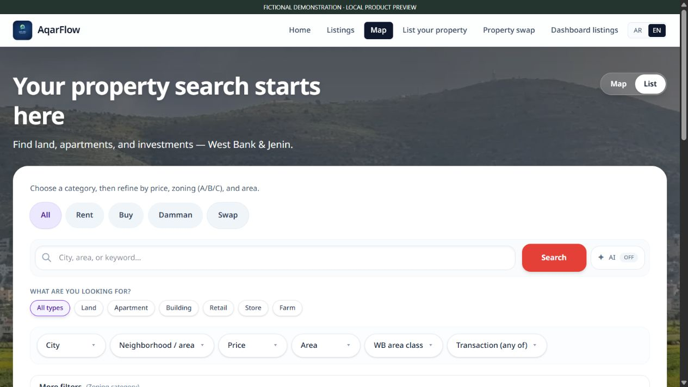
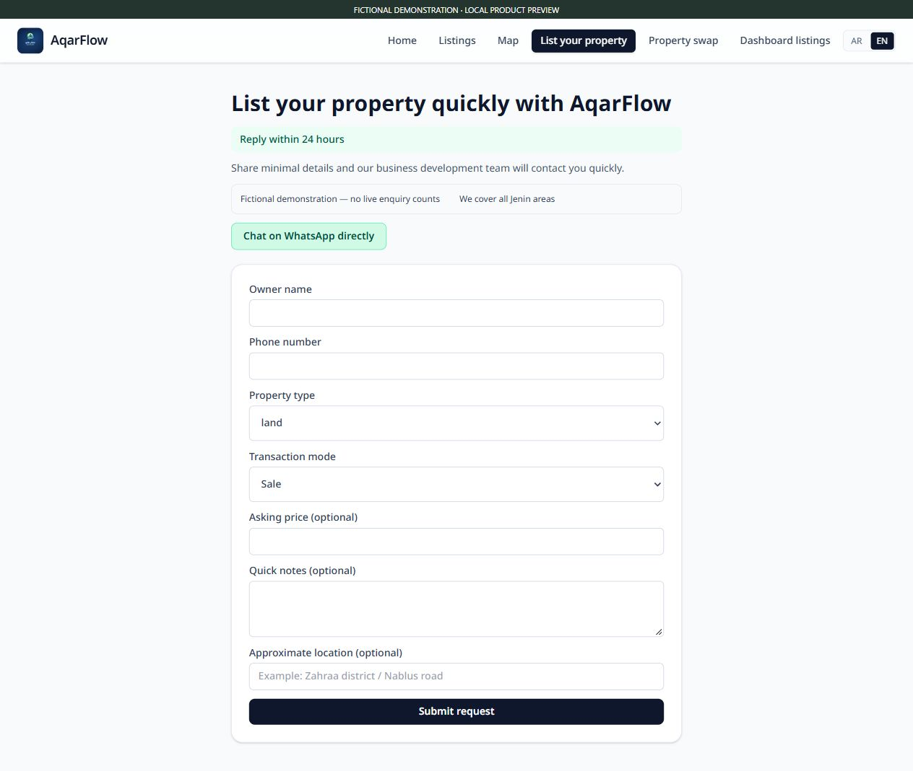
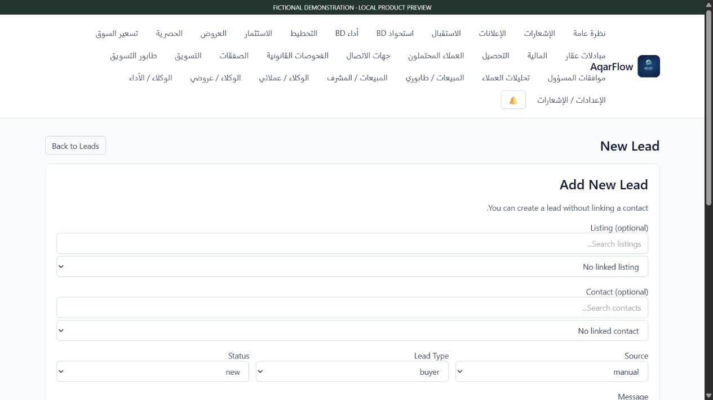

# Aqar · AqarFlow

### From property discovery to brokerage follow-through.

**A real estate platform connecting property search, owner submissions, customer follow-up, offers, and analysis.**

[Founder portfolio](https://github.com/mosaradwan-star) · [Estiqra](https://github.com/mosaradwan-star/estiqra-showcase) · [Estiqra Operate](https://github.com/mosaradwan-star/estiqra-operate-showcase)

**Current public demonstration:** the supplied local product build, captured in an isolated preview with fictional records. The initial market context is Jenin and the West Bank. These screens do not represent customer traction, actual listings, or a live production launch.

## The problem

Finding a property and managing the work behind a transaction are often separate experiences. Buyers browse listings while owners, brokers, and sales teams manage submissions, enquiries, follow-ups, offers, and supporting analysis across disconnected records.

## The product

AqarFlow connects public property discovery with brokerage workflows. Its public interface supports Arabic and English property search, structured filters, listing information, owner intake, enquiries, and property-swap requests. Its operational workspace provides listing management, CRM, offers, planning and investment analysis, and transaction follow-up.

| Product area | Purpose |
| --- | --- |
| **Property discovery** | Browse published properties with location, transaction, property-type, price, and area filters. |
| **Owner intake** | Collect structured property submissions for review and follow-up. |
| **Brokerage CRM** | Organize customers, leads, activities, and next actions around the opportunity. |
| **Offers and transaction workflow** | Track offers, exclusivity records, sales follow-up, and associated operational work. |
| **Property analysis** | Prepare planning and investment analysis alongside the listing and its assumptions. |
| **Property swaps** | Receive and manage structured property-exchange requests. |

## Inside the product

### Property discovery

*Actual product interface with fictional demonstration properties. Asking prices and property details are examples.*

### Owner submission

*A blank intake workflow in the isolated preview; no customer submission is shown or sent.*

### Brokerage CRM

*A demonstration of the product workflow; no real customer contacts or private sales records are included.*

### Investment analysis workspace

*The analysis preparation interface. Any example inputs are fictional and are not market findings or investment results.*

## Who it is for

- Property seekers exploring land, apartments, buildings, retail, and other supported property types.
- Owners submitting properties for review and brokerage follow-up.
- Brokers and sales teams organizing listing and customer workflows.
- Real estate teams connecting a property opportunity with planning and investment analysis.

## Product direction

The direction is to connect discovery, structured property information, and the operational work of a transaction. Aqar complements Estiqra's real estate intelligence and Estiqra Operate's property operations within the founder's product portfolio.

This showcase demonstrates the interface and product scope. Production readiness, live integrations, and commercial traction are not asserted by the demonstration screenshots.

## About this showcase

This repository contains an independently written product overview and four inspected screenshot images. Application source code, credentials, database schemas, internal documents, private records, and Git history are excluded.

Founded by **Rdwan Mousa**. [See the founder portfolio](https://github.com/mosaradwan-star) for the wider product family.

© 2026 Aqar / AqarFlow. All rights reserved. This showcase does not grant rights to the proprietary application source or brand assets.
